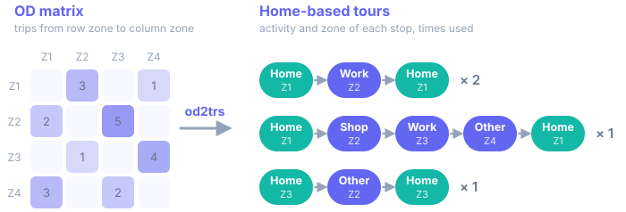

{ width="96" }

# od2trs

**Create trip chains (tours) from OD matrices.**

Origin-destination (OD) matrices describe trips as if they were independent. `od2trs`
recovers the individual **home-based tours** behind them (home → … → home), which is what
activity-based and agent-based models need when person-level data is unavailable.

- :lucide-rocket: **[Getting started](getting-started.md)**

    Install, run the examples and read the results.

- :lucide-table-2: **[Inputs](inputs.md)**

    Schemas and examples of the OD, costs, distribution and zone files.

- :lucide-sliders-horizontal: **[Configuration](configuration.md)**

    Every option of the TOML config.

- :lucide-workflow: **[Method](method.md)**

    How tours are identified and selected.

- :lucide-code-xml: **[API reference](api.md)**

    The Python modules.

- :lucide-quote: **[References](references.md)**

    The papers behind the method, with BibTeX.

!!! quote "Please cite"
    If you use `od2trs` in your work, please cite the papers listed under
    [References](references.md).
