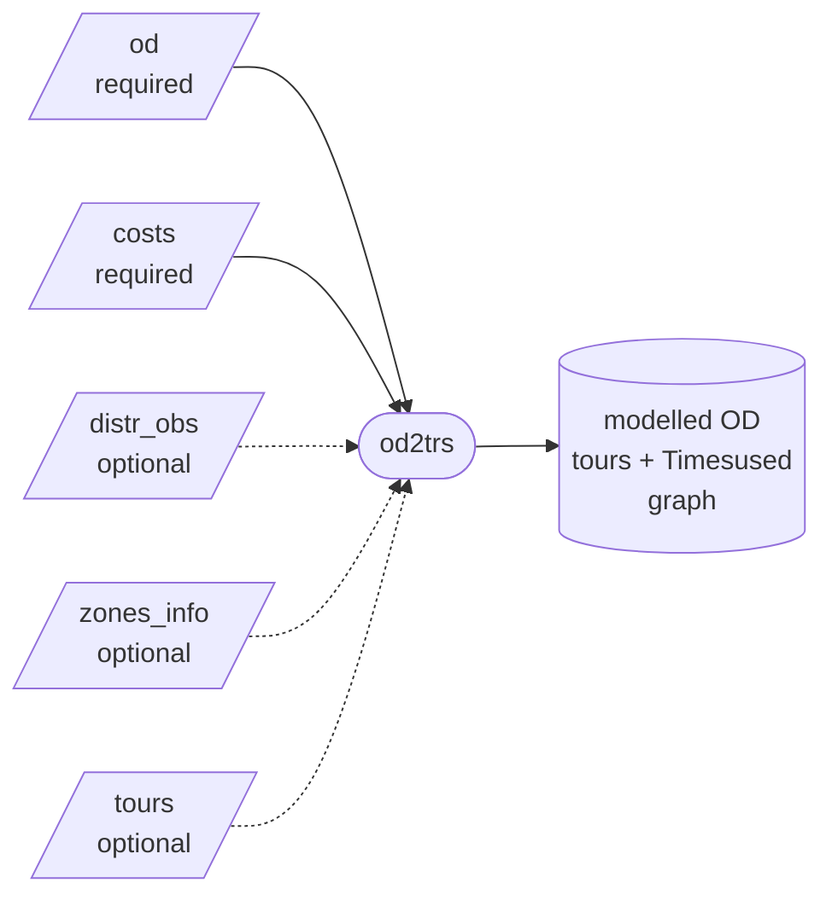

# :lucide-table-2: Inputs

`od2trs` reads up to five input files from the folder given by `inputs.dir`. This page
describes each file's schema, with examples taken from the repository's
[`tests/inputs`](https://github.com/harisbal/od2trs/tree/master/tests/inputs).



| file | config key | required | format |
|---|---|---|---|
| [OD matrix](#od-matrix) | `inputs.od` | always | csv or parquet |
| [Costs](#costs) | `inputs.costs` | always | csv or parquet |
| [Observed distribution](#observed-tour-distribution) | `inputs.distr_obs` | with `optimisation.distribution_constraints` | csv or parquet |
| [Zones](#zones) | `inputs.zones_info` | no | csv or parquet |
| [Identified tours](#identified-tours) | `inputs.tours` | with `tours.identify = false` | csv or parquet |

## :lucide-file-stack: File formats

Every input is a table in **csv** or **[parquet](https://parquet.apache.org/)**; the
format is picked from the file extension (`.csv` or `.parquet`), so the files of one run
may mix formats. The same applies to the `od`, `tours` and `distr_obs` outputs.
Parquet is smaller and keeps column types, which matters most for the
[tours](#identified-tours), the table that can grow large: on the sample data they take
about a quarter of the space of the csv.

The columns are the same in both formats, with these differences for parquet:

- zone ids may be numbers or text; they are read as text, so `1` in the OD matches `1`
  in the costs;
- observed-distribution sequences (`Timeperiods_seq`, `Transports_seq`) may be list
  columns instead of `;`-joined text, and intervals stay text such as `(0, 900]`;
- tours store the per-leg columns as list columns instead of `;`-joined text.

Other extensions raise `Unsupported file format`.

!!! info "Names must agree across files and config"
    The values in the files are matched against the configuration:
    time period names against `[tours.timeperiods]`, `Direction` values against
    `[tours.directions]`, `Purpose` values against `purpose_groups` and
    `purpose_to_activities`, and cost columns against `max_costs`.
    See the [configuration reference](configuration.md).

## :lucide-route: OD matrix

One row per OD cell: the number of trips between two zones, in a time period, for a
purpose and a direction.

=== "Schema"

    | column | type | description |
    |---|---|---|
    | `Orig` | string | Origin zone. |
    | `Dest` | string | Destination zone. |
    | `Timeperiod` | string | One of the names in `[tours.timeperiods]`. |
    | `Purpose` | string | Trip purpose, e.g. `HBW`, `HBO`, `NHB`. Mapped through `purpose_groups`. |
    | `Direction` | string | `FromHome`, `ToHome` or `NonHomeBased` (renamable in `[tours.directions]`). |
    | *other keys* | any | Optional extra dimensions, e.g. `Transport`. |
    | `Trips` | number | Number of trips. **Must be the last column.** |

=== "Example"

    The hand-made 5-zone example (`tests/inputs/od-example.csv`), where `Z` is the
    only home zone:

    ```csv
    Orig,Dest,Purpose,Direction,Timeperiod,Trips
    Z,A,HB,FromHome,AM,3
    Z,A,HB,FromHome,IP,1
    Z,A,HB,ToHome,OP,2
    Z,A,NHB,NonHomeBased,IP,5
    A,B,HB,FromHome,IP,2
    A,B,NHB,NonHomeBased,AM,3
    A,B,NHB,NonHomeBased,PM,5
    ...
    ```

=== "Real-world sample"

    A sample at LSOA level with more purposes and time periods
    (`tests/inputs/od-small.csv`):

    ```csv
    Orig,Dest,Timeperiod,Purpose,Direction,Trips
    E01014370,E01014377,PM,NHBO,NonHomeBased,1
    E01014370,E01014379,PM,NHBO,NonHomeBased,1
    E01014370,E01014382,IP2,NHBO,NonHomeBased,1
    ```

How the file is processed:

- Column names are capitalised on reading (`timeperiod` and `TIMEPERIOD` both become
  `Timeperiod`).
- Rows with the same key are summed, and each distinct key gets an `Odpairid`.
- Values of a column listed in `purpose_groups` are replaced by their group; **values
  without a group are dropped**. This is how you merge purposes
  (`{Purpose = {HBW = "HB", HBO = "HB"}}`) or exclude them.
- Cells with fewer than `trips_thresh` trips and **intrazonal trips** (`Orig == Dest`)
  are dropped. Remaining trips are rounded to integers.
- Every time period in the file must be listed in `[tours.timeperiods]`; the order
  there defines chronological order.
- A `Transport` column, if present, becomes a tour dimension that can be used in
  `distr_dims` (`Transports_seq`).

!!! tip "How many tours does the OD imply?"
    Each tour starts with exactly one from-home trip, so the OD implies as many tours
    as there are `FromHome` trips. Observed-distribution shares are scaled by this
    number.

## :lucide-ruler: Costs

Generalised costs between zones, for example distance and travel time. They bound the
tours (`max_costs`) and group them in the observed distribution (`Distance_grp`).

=== "Schema"

    | column | type | description |
    |---|---|---|
    | `Orig` | string | Origin zone. |
    | `Dest` | string | Destination zone. |
    | *cost columns* | number | One column per cost type, e.g. `Distance`, `Traveltime`. |

=== "Example"

    ```csv
    Orig,Dest,Distance,Traveltime
    E01014370,E01014370,0,0
    E01014370,E01014375,450.8,450.8
    E01014370,E01014377,556.4,556.4
    E01014370,E01014379,951.8,951.8
    ```

- The matrix is directional: provide `Orig → Dest` for every OD cell with trips.
- Costs are in whatever unit you like, as long as `max_costs` and the `_grp` intervals
  of the observed distribution use the same one.
- A cost type that is missing for **any** OD pair is dropped entirely, so keep each
  column complete. A leg with a cost of `0` is treated as unknown when summing a
  tour's cost.

## :lucide-chart-column: Observed tour distribution

Optional. The share of tours falling in each group, typically derived from a travel
survey. With `optimisation.distribution_constraints = true`, tours must fall in an
observed group and the modelled share of each group is kept within
`distribution_tolerance` of the observed one.

The columns used are the ones named in `tours.distr_dims`, plus `Percentage`.

=== "Schema"

    | column | type | description |
    |---|---|---|
    | `<Cost>_grp` | interval | Total tour cost of a cost type in a bin, e.g. `Distance_grp`. |
    | `Timeperiods_seq` | `;`-separated names | Time period of each leg, e.g. `AM;PM`. |
    | `Transports_seq` | `;`-separated names | Transport of each leg (needs a `Transport` column in the OD). |
    | `Nolegs` | integer | Optional. Number of legs; derived from the first `_seq` column if absent. |
    | `Distrgroupid` | integer | Optional. Group id; defaults to the row number. |
    | `Percentage` | number | Share of all tours in the group. Shares should sum to 1. |

=== "Example"

    With `distr_dims = ["Distance_grp", "Traveltime_grp", "Timeperiods_seq"]`
    (`tests/inputs/distr_obs-small.csv`):

    ```csv
    Nolegs,Distance_grp,Traveltime_grp,Timeperiods_seq,Percentage
    2,"(0, 900]","(0, 900]",AM;AM,0.00122499
    2,"(0, 900]","(0, 900]",AM;IP1,0.00285831
    2,"(0, 900]","(0, 900]",AM;IP2,0.005716619
    2,"(0, 900]","(0, 900]",AM;PM,0.013883218
    ```

=== "Config"

    ```toml
    [tours]
    distr_dims = ["Distance_grp", "Traveltime_grp", "Timeperiods_seq"]
    max_costs = {Distance = 8200, Traveltime = 8200}

    [optimisation]
    distribution_constraints = true
    distribution_tolerance = 0.005
    ```

- **Intervals** are written as `(0, 900]`, `[0, 900)`, `[0, 900]` or `(0, 900)`, and
  `inf` is allowed as an upper bound: `(5000, inf)`. A tour belongs to the bin that
  contains its total cost.
- **Sequences** are time period names joined by `;`, one per leg, so `AM;PM` is a
  two-leg tour that leaves in the morning and returns in the afternoon.
- Rows that share the same values on the used dimensions are summed, so a file may
  contain extra columns (like `Traveltime_grp` above when it is not in `distr_dims`).
- Each group's expected number of tours is `Percentage × number of tours`.
  `excl_distr_od_perc` can drop the rarest groups and renormalise the rest.

!!! warning "Dimension names"
    The supported dimensions are `<Cost>_grp` (where `<Cost>` is a column of the costs
    file), `Timeperiods_seq` and `Transports_seq`. `Nolegs` is always added, so there
    is no need to list it in `distr_dims`.

## :lucide-map-pin: Zones

Optional. Zone attributes, attached to the nodes of the saved graph so it can be
inspected or plotted. The file is silently skipped if it does not exist.

| column | type | description |
|---|---|---|
| *first column* | string | Zone id, matching `Orig`/`Dest` (its name does not matter). |
| `X` | number | Longitude or easting. Stored as `Coords = (X, Y)`. |
| `Y` | number | Latitude or northing. |
| *other columns* | any | Kept as node attributes. |

```csv
BoundaryId,X,Y,BoundaryType
E02000001,-0.092101828,51.51482306,MSOA2011
E02000002,0.139501225,51.58827343,MSOA2011
```

Zones that do not appear in the OD are ignored.

## :lucide-package: Identified tours

Only read when `tours.identify = false`. Identifying tours is the slow part, so you can
run it once, then try different optimisation settings on the saved tours.

1. Run with `identify = true` and `run.export_flat = true`. The tours are written to
   `outputs.tours` (default `tours.parquet`; use `tours.csv` for csv).
2. Run again with `identify = false` and `inputs.tours` pointing to that file.

The table is indexed by `Tourid`. Columns that hold one value per leg are lists in
parquet and `;`-joined text in csv, as in the example below:

| column | description |
|---|---|
| `Tourid` | Tour id (first column). |
| `Nolegs` | Number of legs. |
| `Origs` | Origin zone of each leg, e.g. `A;B;C`. |
| `Purposes`, `Directions`, `Timeperiods`, `Transports` | Per-leg attributes, `;`-joined. `Transports` is empty without a `Transport` column in the OD. |
| `Odpairids` | The `Odpairid` of each leg's OD cell, `;`-joined integers. |
| `Acts` | Activity sequence, e.g. `Home;Work;Home`. Empty without `purpose_to_activities`. |
| `Loopscnt` | How many extra times the most revisited zone is visited. |
| `Distrgroupid` | Observed-distribution group, when one was used. |
| *cost columns* | Total tour cost per cost type, e.g. `Distance`. |
| `Timesused` | Optional, written after optimisation. Ignored when reading. |

Two tours from the hand-made example (`tests/configs/example.toml`):

```csv
Tourid,Nolegs,Origs,Purposes,Directions,Timeperiods,Transports,Odpairids,Acts,Loopscnt,Timesused
2,4,A;B;D;Z,HB;NHB;NHB;HB,FromHome;NonHomeBased;NonHomeBased;ToHome,IP;IP;PM;OP,,0;8;15;18,,0,2
3,4,B;A;B;D,HB;NHB;NHB;HB,FromHome;NonHomeBased;NonHomeBased;ToHome,AM;AM;AM;PM,,5;1;7;12,,1,0
```

`Transports` and `Acts` are empty here: the OD has no `Transport` column and the config
has no `purpose_to_activities`.

!!! warning
    `Odpairids` index into the OD, so the OD file and its filters (`trips_thresh`,
    `purpose_groups`) must be the same as in the run that produced the tours.

## :lucide-triangle-alert: Common errors

| message | cause |
|---|---|
| `The last OD column must be Trips` | `Trips` is not the last column of the OD file. |
| `OD time periods missing from config` | A `Timeperiod` value is not in `[tours.timeperiods]`. |
| `Unsupported file format` | An input or output file is not a `.csv` or `.parquet` file. |
| `distribution_constraints requires inputs.distr_obs` | Constraints are on but no distribution file is set. |
| `tours.identify = false requires inputs.tours` | Nothing to read tours from. |
| `Not an interval` | A `_grp` cell is not like `(0, 900]`. |
