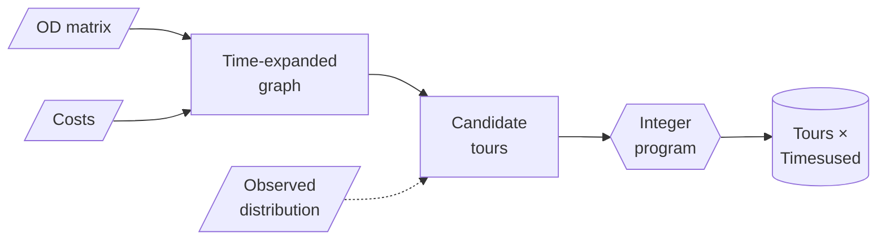
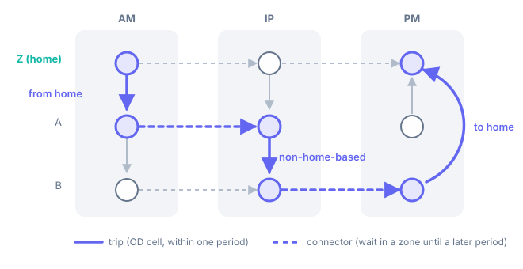

# :lucide-workflow: Method

`od2trs` implements the tour synthesis approach of Ballis & Dimitriou
(references 1 and 2 in [References](references.md)): aggregate
origin-destination (OD) matrices treat trips as independent, so the trips are
re-linked into home-based tours (trip chains) that reproduce the OD.

## :lucide-network: 1. Identification

The multi-period OD is turned into a directed multigraph:

- one node per *(zone, time period)*;
- **trip edges** for each OD cell with trips, from the origin zone to the destination
  zone within the cell's time period;
- **connector edges** between a zone's consecutive time periods (an activity that
  lasts until a later period).

Starting from every home zone, paths are enumerated that leave home on a
*from-home* trip, chain *non-home-based* trips and close with a *to-home* trip. A path
is kept as a candidate tour when

- it has at most `max_legs` legs and its cost is within `max_costs`;
- its purposes map to a consistent activity sequence (`purpose_to_activities`);
- optionally, it falls in a group of the observed tour distribution
  (`distr_dims`, `distr_obs`).

Large networks can be reduced first (`excl_edges_od_perc`, `simplify_net_method`) by
dropping the non-home-based edges around the least central nodes, trading some OD
coverage for tractability.

## :lucide-sigma: 2. Optimisation

An integer program decides how many times each candidate tour is used:

- **maximise** the number of OD trips covered by the selected tours;
- **subject to** no OD cell being used more than its trips;
- and, with `distribution_constraints`, each distribution group's share of the
  tours implied by the OD (one per from-home trip) deviating from the observed share by
  at most `distribution_tolerance`.

The model is built as sparse matrices and solved with HiGHS.

## :lucide-book-open: Further reading

The multimodal extension and its scalability on megacity-sized ODs are covered in
Ballis & Dimitriou (2021). Full citations are in the README and in
[`references.bib`](references.bib).
